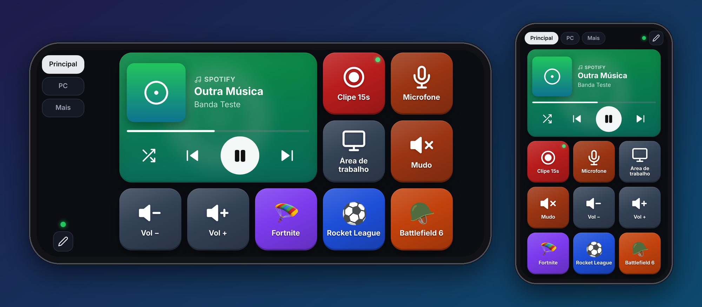
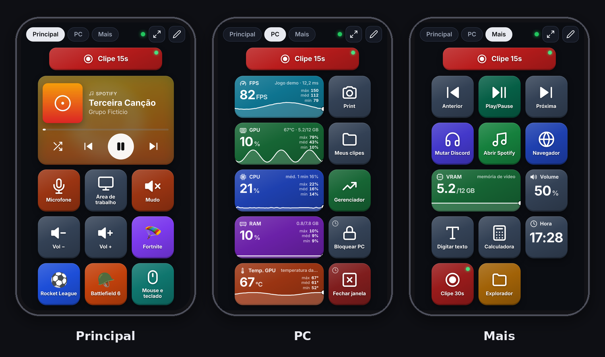
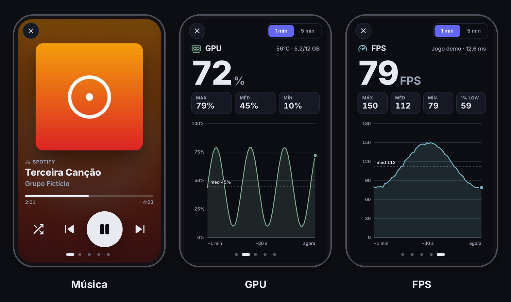
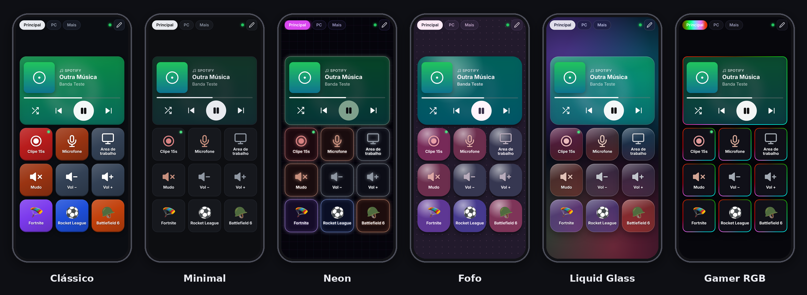
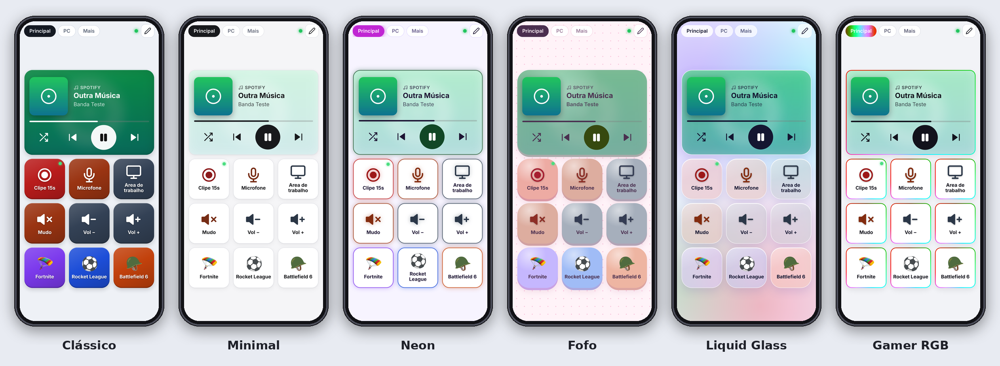
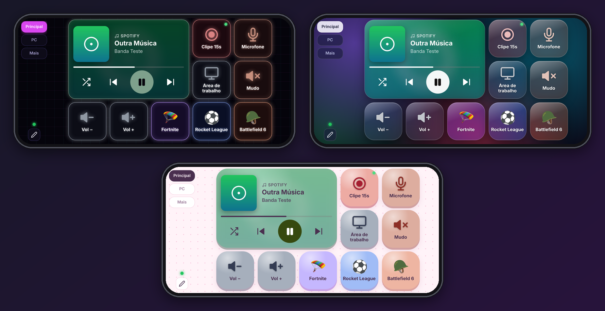
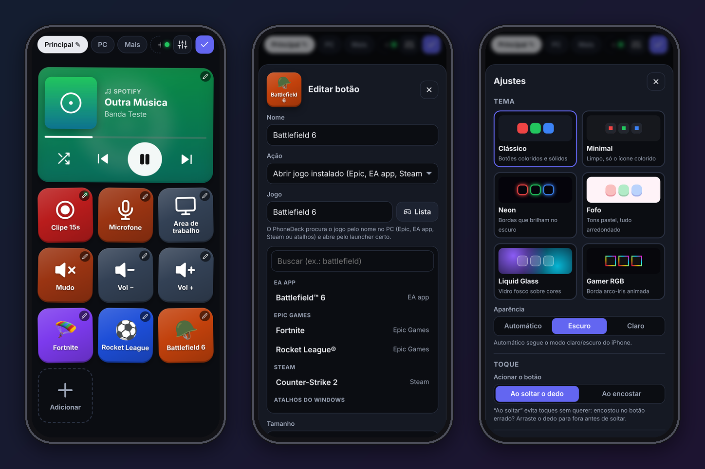
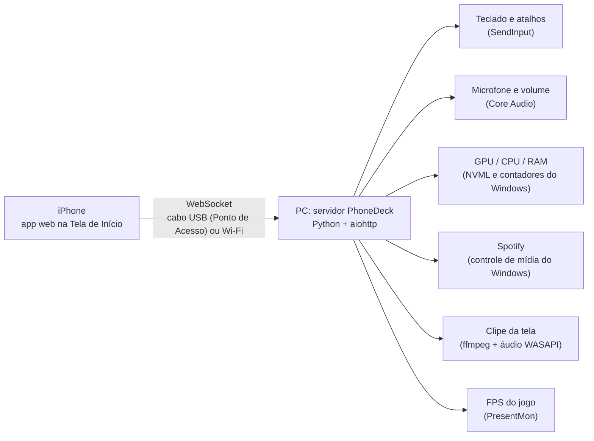
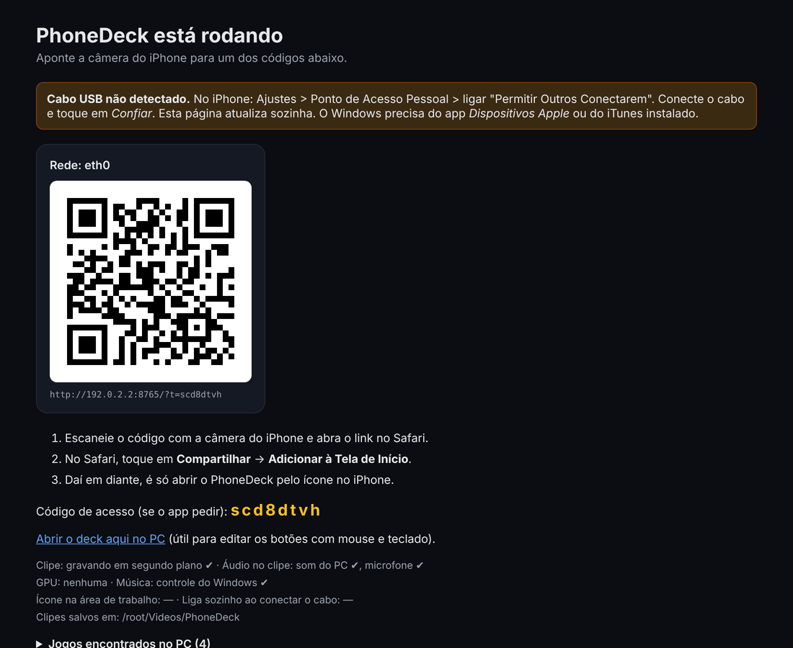

<p align="center">
  
</p>

<h1 align="center">PhoneDeck</h1>

<p align="center">
  <b>Transforme o seu iPhone num Stream Deck do PC — pelo cabo USB ou pelo Wi-Fi, sem App Store.</b><br>
  Botões grandes e 100% editáveis · toque à prova de engano · clipe dos últimos 15 s com som e microfone · gráficos de GPU/CPU/RAM · painel do Spotify · 6 temas
</p>

<p align="center">
  
  
  
  
</p>

<p align="center">
  
</p>

---

## O que ele faz

| | |
|---|---|
| 🎬 **Clipe dos últimos segundos** | Grava a tela em segundo plano e salva os últimos 15 s (ou 30 s) num `.mp4`, **com o som do PC e o microfone**. Usa a placa de vídeo (NVIDIA, AMD ou Intel) com prioridade alta e confere cada clipe ("30 fps ✔"). |
| 📈 **Gráficos ao vivo** | GPU, CPU, RAM, temperatura e VRAM com gráfico do último minuto e máx / méd / mín ao lado. |
| 🖥️ **Tela cheia** | Toque num gráfico ou no painel de música para ver em tela cheia e deslize para passar por música, GPU, CPU, RAM e FPS (você escolhe quais e a ordem). |
| 🎯 **FPS do jogo** | FPS do jogo aberto com gráfico, máx, méd, mín e 1% low. Funciona em qualquer jogo, sem sobreposição na tela (usa o PresentMon da Intel). |
| 🎵 **Painel do Spotify** | Capa, música e artista, com aleatório, voltar, play/pause e próxima. |
| 🎮 **Jogos e apps** | Acha sozinho os jogos instalados na **Epic, EA app e Steam** e abre pelo launcher certo, além de qualquer programa, pasta ou site. |
| 🎙️ **Controles do PC** | Mutar microfone (fica vermelho quando mutado), volume, mudo, área de trabalho, print, bloquear o PC. |
| 🖱️ **Mouse e teclado** | O celular vira touchpad (clique, botão direito, rolagem com 2 dedos, arrastar) e teclado para mexer no PC de longe. |
| 📌 **Botões fixos** | Até 3 botões que aparecem em todas as páginas e na tela cheia. Vem com o **Clipe 15s** fixo no topo. |
| ⌨️ **Atalhos e macros** | Qualquer combinação de teclas (`ctrl+shift+m`) ou sequências (`ctrl+c, alt+tab, ctrl+v`), digitar textos e rodar comandos. |
| 👆 **Toque à prova de engano** | Botões grandes (3 colunas em pé, 5 deitado) e páginas que trocam deslizando para o lado. O botão só aciona quando você solta o dedo: encostou no errado, arraste para fora. Botões perigosos pedem para segurar. |
| ✏️ **Totalmente editável** | Pelo próprio celular: nome, ícone (ou emoji), cor, ação, tamanho do bloco e posição, páginas e número de colunas. |
| 🎨 **Temas** | Clássico, Minimal, Neon, Fofo, Liquid Glass e Gamer RGB, cada um com modo claro, escuro ou automático. |
| 🔌 **Liga sozinho** | Ícone na área de trabalho e início automático: conectou o cabo do iPhone, o PhoneDeck acorda e avisa. |

## Páginas

<p align="center"></p>

**Principal** tem o dia a dia (Spotify, clipe, microfone, volume e jogos), **PC** tem o FPS do jogo, os gráficos e as ferramentas, e **Mais** tem o resto.
Cada página cabe na tela sem rolar, com botões grandes. Para trocar de página, deslize para o lado.

## Tela cheia

<p align="center"></p>

Toque num gráfico ou no painel de música e deslize para os lados: controles de música grandes, e gráficos com escala, máx / méd / mín, 1% low no FPS e escolha entre 1 e 5 minutos. A tela do iPhone não apaga enquanto ela está aberta.

## Temas

<p align="center"></p>
<p align="center"></p>
<p align="center"></p>

## Edite tudo pelo celular

<p align="center"></p>

Toque no lápis, toque num botão e mude o que quiser. Os blocos podem ter vários tamanhos (1×1, 2×1, 2×2, 3×2…), e a grade se encaixa sozinha com o celular em pé ou deitado.

## Como funciona



* O **PC** roda um servidor pequeno em Python. Ele também entrega o app do celular.
* O **iPhone** abre esse app no Safari e o instala na Tela de Início, onde ele abre em tela cheia como um app normal. Não precisa de App Store, Mac nem conta de desenvolvedor.
* **Pelo cabo:** com o *Ponto de Acesso Pessoal* ligado, o iPhone cria uma rede pelo USB e o app conversa com o PC por ela. **Pelo Wi-Fi:** basta os dois estarem na mesma rede.
* Só entra quem tem o **código de acesso** (vai embutido no QR code).

## Instalação rápida

1. Baixe este repositório (**Code › Download ZIP**) e descompacte.
2. Dê dois cliques em **`iniciar.bat`**. Se o Python não estiver instalado, ele oferece instalar sozinho.
3. Instale o **ffmpeg**, usado pelo clipe: `winget install --id Gyan.FFmpeg -e`
4. Para usar o cabo, instale o app **Dispositivos Apple** (Microsoft Store) ou o **iTunes**.
5. No iPhone, ligue **Ajustes › Ponto de Acesso Pessoal › Permitir Outros Conectarem** e conecte o cabo.
6. Escaneie o QR code que aparece no PC, depois toque em **Compartilhar › Adicionar à Tela de Início**.

O `iniciar.bat` também cria o ícone **PhoneDeck** na área de trabalho e o início automático com o Windows.

<p align="center"></p>

📘 **Guia completo:** [docs/GUIA.md](docs/GUIA.md) (configurações, clipe com som, temas, problemas comuns).

## Estrutura do projeto

```
PhoneDeck/
├─ iniciar.bat            instala, cria os atalhos e liga em segundo plano
├─ modo_console.bat       abre com janela visível (para ver erros)
├─ remover_atalhos.bat    tira o ícone e o início automático
├─ criar_exe.bat          gera um PhoneDeck.exe (opcional)
├─ servidor/              servidor do PC (Python)
│  ├─ main.py             servidor web/WebSocket, modos, detecção do cabo
│  ├─ actions.py          o que cada botão faz        ← ações novas entram aqui
│  ├─ clipper.py          gravação contínua da tela e corte do clipe
│  ├─ audiocap.py         som do PC + microfone para o clipe
│  ├─ media.py            painel de música (controle de mídia do Windows)
│  ├─ games.py            encontra jogos da Epic, EA app, Steam e atalhos
│  ├─ stats.py            CPU, RAM e GPU
│  ├─ fps.py              FPS do jogo aberto (PresentMon)
│  ├─ audio.py · winkeys.py · atalhos.py · config.py
└─ web/                   app do celular (HTML/CSS/JS puro, sem dependências)
```

## Perguntas rápidas

**Funciona com Android?** Pelo Wi-Fi, sim. Pelo cabo, em geral funciona ativando a "Ancoragem USB" do Android.<br>
**Funciona no Mac ou no Linux?** O servidor roda em modo demonstração (para desenvolver a interface), mas as ações usam APIs do Windows.<br>
**Precisa de internet?** Não. Tudo fica entre o celular e o PC (só a primeira instalação baixa as bibliotecas e o PresentMon).<br>
**O microfone fica gravando?** Só enquanto o clipe está ativo, e só os últimos segundos, guardados na memória RAM. Nada vai para o disco até você apertar o botão de clipe. Dá para desligar no `settings.json`.

## Contribuindo

Ideias e correções são bem-vindas: abra uma *issue* ou um *pull request*.
Para testar a interface sem Windows, rode `python servidor/main.py`: fora do Windows ele entra em **modo demonstração**, com dados fictícios.

## Aviso

Projeto independente e sem afiliação com Elgato/Corsair (Stream Deck), Apple, Microsoft, Spotify, Epic Games (Fortnite, Rocket League) ou Electronic Arts (Battlefield). Os nomes são marcas dos seus donos. Os botões de jogos só abrem os jogos que você já tem instalados.

## Licença

[MIT](LICENSE)

---

<details>
<summary><b>English summary</b></summary>

**PhoneDeck** turns an iPhone into a fully customizable Stream Deck for a Windows PC, over a USB cable (via Personal Hotspot) or Wi-Fi, with no App Store install. The phone runs a home-screen web app, and the PC runs a small Python (aiohttp) server.

Features: an instant-replay clip of the last 15 s with system audio and microphone, live GPU/CPU/RAM sparklines, a Spotify panel (art, shuffle, prev/play/next), game and app launchers, mic mute, volume, hotkeys and macros, resizable tiles, six themes with light/dark modes, and auto-start when the cable is plugged in.

Quick start: run `iniciar.bat`, scan the QR code, then choose *Add to Home Screen*. The UI is in Brazilian Portuguese.
</details>
